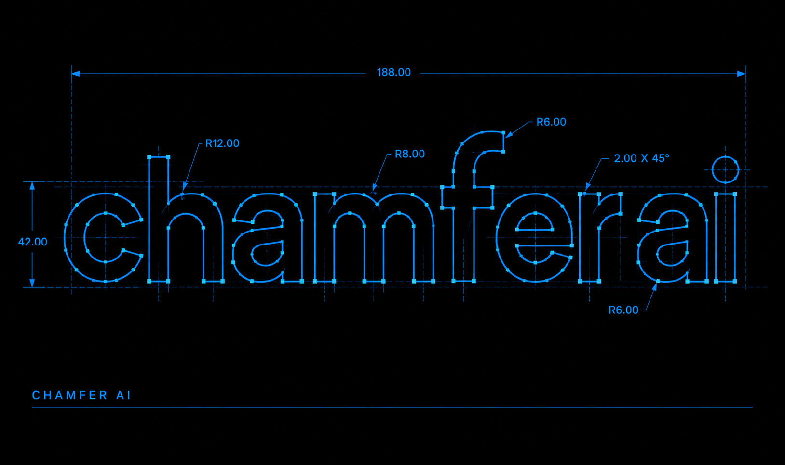
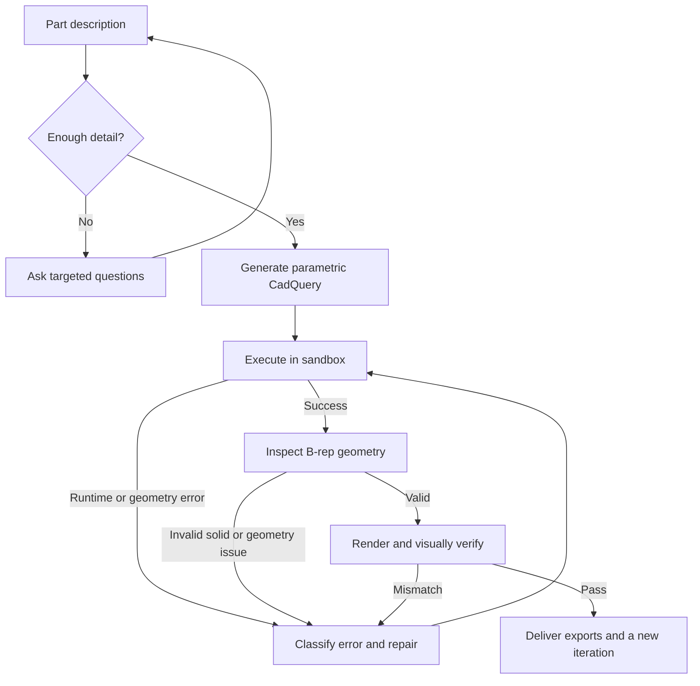
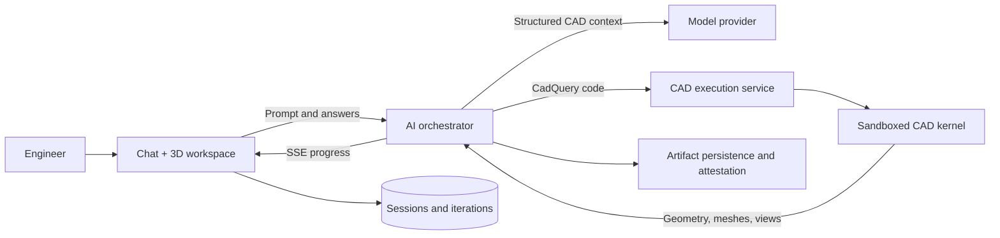

<p align="center">
  
</p>

<h1 align="center">Chamfer AI</h1>

<p align="center">
  Describe a part. Get a parametric CAD model that was executed, inspected, and repaired — not just generated.
</p>

<p align="center">
  <a href="#what-chamfer-ai-does">What it does</a> ·
  <a href="#why-it-exists">Why it exists</a> ·
  <a href="#how-it-works">How it works</a> ·
  <a href="#getting-started">Getting started</a> ·
  <a href="#architecture">Architecture</a>
</p>

---

## What Chamfer AI does

Chamfer AI turns a plain-language part description into a real, parametric CAD model.

It does not stop at a code snippet or a pretty mesh. It writes CadQuery code, runs it in a sandboxed CAD kernel, inspects the resulting geometry, renders the part from multiple angles, and repairs its own mistakes before handing you the files.

The output is a model you can keep working with:

- **Parametric** — dimensions are exposed as parameters, not baked into a mesh.
- **Executed** — the geometry actually ran; it is not a generated preview.
- **Inspected** — solids, faces, volume, bounding box, and B-rep validity are checked.
- **Export-ready** — STL, STEP, GLB, dimensional views, and the underlying code.
- **Versioned** — every iteration is attached to its chat turn, with preview and rollback.

Built for brackets, enclosures, adapters, fixtures, replacement parts, and the long tail of mechanical design that should not require a full CAD session to get started.

---

## Why it exists

CAD is where an idea becomes physical, but the path there is expensive and repetitive:

1. An engineer interprets a rough requirement.
2. They rebuild the same families of features in a CAD package.
3. They export, inspect, and repeat when a dimension or constraint is wrong.

Text-to-3D tools skip the engineering. They produce a mesh that looks plausible but cannot be edited parametrically, inspected as a solid, or trusted for fabrication. One-shot code assistants can write CadQuery, but a single syntax or geometry error stops the workflow — and the user is left debugging generated code.

Chamfer closes the loop. The model is not "done" because code was produced; it is done when the code runs, the geometry is valid, and the rendered result matches the request.

---

## What makes it different

| | Chat-only CAD assistant | One-shot code generator | Manual CAD | **Chamfer AI** |
| :--- | :--- | :--- | :--- | :--- |
| **Input** | Text | Text | Manual modeling | Text, answers, reference images |
| **Output** | Advice or snippets | Code | Native model | Executed parametric model + STEP/STL/GLB |
| **Validation** | None | Syntax at best | Human review | B-rep inspection + multi-view renders |
| **Failure handling** | User fixes it | Regenerate and hope | Manual repair | Classified error, targeted repair, bounded retries |
| **Parameter changes** | Rewrite the prompt | Rewrite the prompt | Edit the feature tree | Sliders re-execute the same model |
| **Iteration history** | Chat log | Prompt history | Undo stack | Versioned iterations with preview and rollback |
| **Deliverables** | Text | Code | Native CAD files | Code, parameters, STL, STEP, GLB, dim views |

The difference is not a bigger model. It is the **verification loop**: geometry is the source of truth, and the agent is allowed to see its own result and fix it.

---

## How it works



### 1. Understand the request

Ambiguous prompts are clarified before generation. Chamfer asks for the dimensions, features, tolerances, or constraints that materially change the model, then carries those answers into the CAD context.

### 2. Generate parametric code

The model writes CadQuery Python from a structured CAD skill: primitives, booleans, selectors, fillets, patterns, and parameter definitions. The result is code, not a mesh — which is what makes the model editable and reproducible.

### 3. Execute in a sandbox

The code runs inside a locked-down Docker container with no network access, a memory cap, a CPU cap, a timeout, a read-only root filesystem, and dropped capabilities. A failed run is contained; it cannot touch the host.

### 4. Inspect the geometry

The CAD kernel reports the facts a mesh cannot: solid validity, volume, surface area, bounding box, face/edge/vertex counts, center of mass, and topology warnings. This is the difference between "the script ran" and "the part is valid."

### 5. Verify visually

The model is rendered from multiple angles, including top/front/side dimensional views and PNG snapshots. A vision pass can compare the render against the original request and flag shape-level mistakes that geometry checks alone would miss.

### 6. Repair, don't rewrite

Failures are classified — syntax, imports, sandbox restrictions, fillet/chamfer limits, boolean failures, build order, selectors, timeouts, memory, and more. The model receives the actual error, the failing code, and a targeted hint, and is asked for the smallest change that resolves it. Retries are bounded.

### 7. Deliver and iterate

A successful run produces:

- STL, STEP, and GLB exports
- The underlying CadQuery code
- Model parameters
- Inspection data
- Multi-view and dimensional renders

Changing a parameter re-executes the same model instead of regenerating it from scratch. Storing that result creates a new version, preserving the previous one.

---

## Product surface

| Area | What the user gets |
| :--- | :--- |
| **Conversational CAD** | Describe a part, answer clarifying questions, and watch the workflow live |
| **3D workspace** | Interactive STL viewer, camera presets, inspection HUD, and dimensional views |
| **Parametric editing** | Sliders re-run the model with new values; the geometry updates in place |
| **Geometry inspection** | Volume, faces, edges, bounding box, solid validity, warnings |
| **Visual verification** | Multi-view renders and an optional vision review of the result |
| **Iteration history** | Every version attached to its turn; preview an old version or roll back |
| **Exports** | STL, STEP, GLB, code, parameters, and dimensional views |
| **Workspace continuity** | Sessions, messages, reasoning, workflow state, and iterations restore on reload |

---

## Architecture



**Frontend** — React 19, Vite, TypeScript, Three.js, Tailwind CSS, Framer Motion, Web3Auth/Wagmi.

**AI orchestrator** — Express and TypeScript. Streams the workflow over SSE, builds CAD context, calls the configured model provider, classifies failures, and drives bounded repairs.

**CAD service** — FastAPI and Python. Launches the sandboxed CadQuery executor, runs parameter updates, and returns geometry, inspection data, snapshots, and dimensional views.

**Persistence** — Supabase for profiles, chat sessions, messages, and iteration metadata. Completed artifacts can be content-addressed and persisted through the artifact layer.

**Model providers** — OpenAI-compatible endpoints configured in `backend/ai-server/src/config.ts`. The CAD pipeline is not tied to a single model vendor.

---

## Verification and persistence

The product is built around verifiable results, not infrastructure branding.

- **Execution proof** — the model must run in the CAD kernel to be delivered.
- **Geometry proof** — the B-rep must pass inspection before it is treated as a valid result.
- **Visual proof** — the rendered part is compared against the request when vision is enabled.
- **Artifact persistence** — completed artifacts can be content-addressed and persisted to 0G Storage; supported compute responses can carry TEE attestations. The UI surfaces that verification state so a team can see what was generated and how it was checked.
- **Honest failure** — an exhausted run is reported as a best-effort result or an error, never as a silent success.

0G Storage and TEE attestation are supporting infrastructure for persistence and verification. They are not the product surface, and the generation workflow is not tied to a single model vendor.

---

## Getting started

### Prerequisites

- Node.js 20+
- Python 3.12+
- Docker Desktop or Docker Engine (the CAD sandbox requires it)
- A Supabase project
- Credentials for at least one configured model provider

### 1. Database

In the Supabase SQL Editor, run:

1. `docs/supabase_schema.sql`
2. `docs/supabase_migration_v2.sql` through `docs/supabase_migration_v7.sql`, in order

The v7 migration adds the append-only iteration history and full-fidelity message metadata. Without it, iteration history and restore behavior are incomplete.

### 2. Backend

```bash
cp backend/ai-server/.env.example backend/ai-server/.env
# Fill in Supabase, model-provider, and artifact-storage values.

cd backend
docker compose up -d --build
```

This starts the AI server on `:4000` and the CAD API on `:6001`, and builds the sandbox executor image. The AI server talks to the CAD service at `http://cad-server:5000` inside the Compose network.

If you run the AI server outside Compose:

```bash
cd backend/ai-server
npm install
# Set CAD_SERVER_URL=http://localhost:6001 in .env
npm run dev
```

### 3. Frontend

```bash
cp frontend/.env.example frontend/.env
# Set VITE_WEB3AUTH_CLIENT_ID and VITE_API_URL.

cd frontend
npm install
npm run dev
```

Open `http://localhost:3000`.

### 4. First run

1. Connect a wallet.
2. Describe a part, for example: *"Design a mounting bracket for a 40 mm fan with four M4 holes."*
3. Answer any clarifying questions.
4. Watch the workflow: analyze → generate → execute → inspect → verify → deliver.
5. Adjust a parameter and confirm the geometry re-executes.
6. Export STEP, STL, or GLB.

Docker must be running before the first generation; the CAD service spawns a sandbox container for every execution.

---

## Configuration

### Frontend (`frontend/.env`)

| Variable | Purpose |
| :--- | :--- |
| `VITE_API_URL` | AI server URL. Leave empty to use the Vite `/api` proxy to `localhost:4000`. |
| `VITE_WEB3AUTH_CLIENT_ID` | Web3Auth client ID for wallet login |

### AI server (`backend/ai-server/.env`)

| Variable | Purpose |
| :--- | :--- |
| `PORT` | AI server port (default `4000`) |
| `CAD_SERVER_URL` | CAD service URL. Use `http://cad-server:5000` in Compose; `http://localhost:6001` for bare metal. |
| `SUPABASE_URL` | Supabase project URL |
| `SUPABASE_SERVICE_KEY` | Supabase service role key (server-side only) |
| `OG_API_KEY`, `OG_BASE_URL`, `OG_MODEL` | Compute provider configuration when the 0G provider is enabled |
| `OG_PRIVATE_KEY`, `OG_RPC_URL`, `OG_INDEXER_RPC`, `FILE_MASTER_KEY` | Artifact persistence configuration |
| `FIREWORKS_API_KEY`, `MUSE_API_KEY`, `MUSE_BASE_URL` | Alternate OpenAI-compatible providers |
| `GROQ_API_KEY` | Optional legacy provider; disabled by default in `config.ts` |
| `SSE_HEARTBEAT_MS`, `PROVIDER_*_TIMEOUT_MS`, `MAX_VISION_FIXES` | Streaming and generation tuning |

Only the providers and storage paths you enable need credentials. Secrets belong in `.env` files and are ignored by Git.

### Authentication

Wallet connection is the identity layer: the connected address is sent as the Bearer token, and the backend validates its format. There are no passwords or separate accounts. Generation is blocked in the UI until a wallet is connected.

---

## Project structure

```text
chamfer-ai/
├── frontend/                  # React workspace, chat, 3D viewport, inspection
├── backend/
│   ├── ai-server/             # Express orchestrator, SSE, providers, repair loop
│   └── cad-server/            # FastAPI CAD API + sandboxed CadQuery executor
├── docs/
│   ├── supabase_schema.sql
│   └── supabase_migration_v*.sql
└── tests/                     # Python unit and integration tests
```

---

## Testing

```bash
# AI server
cd backend/ai-server
npm test

# Frontend
cd frontend
npx tsc --noEmit
npm run build

# Python unit tests
python -m pytest tests/unit -q

# Integration tests (requires Docker)
python -m pytest tests/integration -q
```

The AI server test suite covers the effort ladder, syntax-error formatting, iteration planning, and TEE verification. The CAD integration tests exercise the sandbox through the running Compose stack.

---

## Design principles

- **Geometry is ground truth.** Code that compiles is not a finished model.
- **Verify before delivery.** Inspect the solid, render it, and compare it with the request.
- **Repair the smallest thing.** A targeted fix preserves the design intent better than a rewrite.
- **Keep the history.** Every iteration is reproducible, previewable, and reversible.
- **Never fake success.** Failed runs are surfaced; best-effort results are labeled.
- **Keep infrastructure replaceable.** Model providers and persistence sit behind interfaces, not in the product story.

---

## Limitations

- Chamfer AI is a design assistant, not a substitute for engineering review. Safety-critical or regulated parts still require a qualified engineer.
- The CAD sandbox has CPU, memory, and time limits; extremely large or feature-dense models may need a simpler decomposition.
- Docker is required for execution; the frontend alone cannot generate geometry.
- Vision and geometry checks reduce errors but do not eliminate them. The exported model should be reviewed before fabrication.
- Session restore and iteration history depend on the database migrations being applied.

---

## Contributing

1. Fork the repository and create a focused branch.
2. Keep the CAD sandbox restrictions intact.
3. Add a test for every new failure class or repair path.
4. Run the relevant test and build commands above.
5. Open a pull request with the problem, the approach, and the verification evidence.

For security issues, contact the repository owner privately instead of opening a public issue.

---

## License

No license file is currently included. Contact the repository owner before commercial use.
